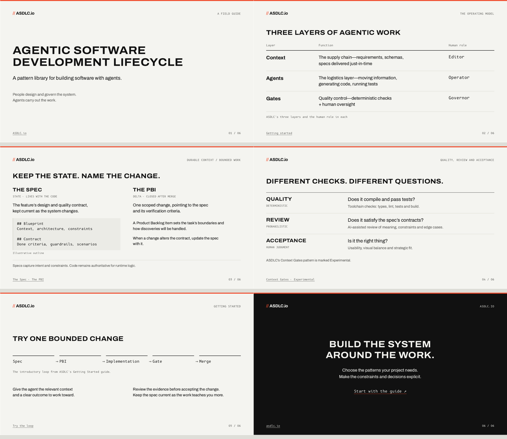

---
generated:
  by: openai/gpt-6
  at: 2026-10-17T20:47:27+03:00
---

# Kata usage in the ASDLC deck rebuild

17 October 2026

The owner judged the rebuilt ASDLC deck **better formatted than the earlier version, but still quite packed**. This revises the initial delivery assessment: grouping and hierarchy improved, yet individual items still ask too much of the viewer. The rebuild is an improvement with an unresolved density problem, not an accepted composition.

The rebuild increased the principal visible copy from about **197 to 284 words**, while retaining six slides. Its Spec/PBI comparison carries 89 words, including several labels, a code outline and a shared qualification. More orderly placement made this material fit; it did not establish that the amount and visual weight were appropriate for an introduction.

The deck retains the existing 16:9 Lys surface and scroll-snap navigation. Kata 0.5.1 was applied as delivered, with no edits to its gateway, forms, practices or integration guidance. This report records the comparison and owner feedback without changing the deck or shared guidance.

- [Built standalone deck](../../site/examples/themed.html)
- [Maintained source](../../examples/themed.html)
- [Authored content record](asdlc-kata-0.5.1-content.json)
- [Verification record](asdlc-kata-0.5.1-checks.json)
- [Comparison evidence and copy counts](asdlc-kata-0.5.1-comparison.json)

## Comparison with the earlier ASDLC deck

The baseline is `examples/themed.html` at `f28a9c1`, immediately before rebuild `56e3d48`. Both have six slides, a 16:9 surface and the same Lys runtime. The earlier HTML was reconstructed at **1280×720** with its authored content and layout CSS intact. The unchanged Lys 1.2.5 renderer and the rebuilt deck's embedded Archivo/B612 fonts replaced external asset references. This is a reconstruction, not a capture of the original browsing session.

Content, representations and styling changed together. The comparison cannot isolate Kata's effect, and the earlier deck is a historical baseline rather than a proven example of work without Kata.

| Dimension | Earlier deck | Rebuilt deck and assessment |
| --- | --- | --- |
| Identity | Already used warm paper, black, orange, Archivo and B612 Mono, with expanded uppercase headings. | Applies the same identity through a wordmark, stable edges, restrained rules and technical labels. Reinvestigation confirmed the identity; it did not introduce a previously absent palette or font pairing. |
| Opening and closing | Sparse centred title; closing statement with a literal broken `&fleur;` entity. Secondary text was faint on black. | A left-aligned explanatory opening and centred closing with a guide link. More useful context, but also more copy. These are still the quieter new items; the density criticism should not be flattened into a claim that every slide is equally crowded. |
| Informational material | Two five-bullet lists, a boxed workflow and a large dark code block. | A three-layer table, Spec/PBI comparison, three gate rows and a restrained workflow. Relationships are more explicit, while the deck covers more concepts. |
| Type at 1280×720 | Informational headings 36 px; list text 24 px; opening title 72 px. | Informational headings about 34 px; most ordinary text about 19–24 px; opening title about 56 px. The heading reduction is modest. Captions and type labels reach roughly 12–13 px. The closing statement is larger than before, about 46 versus 36 px. |
| Principal visible copy | About 197 words. | About 284 words, an increase of 44%. More hierarchy accommodates more writing. This excludes recurring headers, source footers, page numbers and notes; it is not a readability score. |
| Spec material | A roughly 50-word code example spread over many lines. Its 580 px content height exceeded the 517 px code viewport, hiding the end until internal scrolling. | An 89-word comparison with a shorter code outline, two definitions, PBI explanation and a shared qualification. The code is fully shown, but the whole item carries a greater explanatory burden. |
| Source accuracy | Old name expansion and claims such as deterministic agent output. | Current name and qualifications about runtime authority and experimental gates. These corrections come from source authoring, not composition guidance. |

The [comparison record](asdlc-kata-0.5.1-comparison.json) contains the text and counting method. Hyphenated terms count as one word and punctuation alone is excluded. The middle four slides increased from 185 to 239 words, so the increase is not confined to the opening and closing. Subjects and order changed; matching slide numbers would imply a false comparison of identical material.

## Owner review and remaining density

The owner wrote: “This also feels a quite packed - but still better formatted than the earlier”. The diagnosis below is the agent's interpretation of that feedback and the rendered work.

**Spec and PBI is the strongest case.** The main distinction, durable state versus bounded change, shares the surface with a code example, a definition of Product Backlog Item, how discoveries are handled, an update rule and the runtime-authority qualification. Equal columns organise those parts; they do not remove the several explanations the reader must work through. The grey code panel gives the left field visual mass that matching widths alone do not balance.

**The gates have clear rows but many reading levels.** Each row contains a tier name, a technical classification, a question and an explanation. A heading, section label, experimental qualification and source line surround them. The rows support comparison, while the accumulated labels and explanations can still feel like a compact reference sheet. The operating-model table similarly preserves useful associations without reducing the amount the viewer must read.

**The workflow is visually lighter.** Rules replace heavy black boxes, and more space surrounds its parts. Yet the heading, figure, caption and two supporting paragraphs remain separate reading groups. Open margins can coexist with substantial reading demand; adding more blank space alone would not necessarily resolve it.

The recurring wordmark, section labels and footers strengthen orientation but add visible material. Smaller support text helps fit the content while creating more levels to inspect. Shrinking everything further would risk making necessary context harder to use.

## Kata contribution and limits

Kata's **one focus** form supports the opening and closing. **Equal peers** supports comparable Spec/PBI headings and the aligned gate rows. Shared practices keep captions and qualifications associated with their subjects, preserve the supplied table and workflow, and give headings a subordinate role on informational items. Those decisions are visible in the result, although the comparison cannot attribute them exclusively to the skill.

The existing [practices](../../.agents/skills/kata/references/practices.md#refine-and-inspect) already address hierarchy, balance, whitespace, restraint and recommending separation. The [forms](../../.agents/skills/kata/references/composition.md) explicitly distinguish equal visual weight from equal width. Those ideas were available. The unresolved question is how effectively the agent translated them into decisions, and whether their expression needs to become more actionable.

The practical gap was a **stopping judgment**. The agent accepted an arrangement that fit, preserved the material and had an explainable structure. It did not adequately reject the complete item as too demanding. The skill's density paragraph gives a concrete escalation when material cannot fit; this case also requires recognising when material **does fit but remains too demanding**. Named forms and successful containment checks do not answer that question.

The initial alternatives were written rationales, not rendered comparisons. Their existence showed that alternatives had been considered, but did not demonstrate that the selected scale and balance were preferable. Inspection found delivery defects while missing the density problem subsequently raised by the owner.

## Authoring decisions and the earlier Northern Lights finding

The user requested the same Lys features, not a mandatory six-slide limit. Retaining six slides was the agent's choice. The agent also selected the source material, added explanations and froze the slide boundaries before composition. That record made preservation testable; it did not make those authoring choices beyond review.

Kata should not silently shorten the supplied copy, remove qualifications or redesign the internal workflow. It can recommend separating an overloaded item. In this use, the agent could have returned that recommendation to its authoring work. Instead it largely treated the frozen material as a packing task. That was a workflow decision around Kata, not a requirement imposed by the skill.

The laptop, desktop or shared-screen target at 1280×720 was more concrete than in the [Northern Lights run](free-fall-northern-lights-kata-0.5.1.md). It still did not distinguish a presenter-supported introduction from material intended for independent reading. That distinction would inform how much explanation belongs on the surface without giving Kata responsibility for writing or sequencing the deck.

Northern Lights, at 24:10, was criticised for packed, oversized text, poor balance and illegibility. ASDLC, at 16:9, receives the narrower judgment of better formatting but continued density. Its informational type is more restrained. The recurring concern therefore cannot be explained solely by the cinema aspect ratio or by every heading being too large.

Across these two uses, the recurring failure is accepting organised, technically fitting text as sufficient evidence of successful composition. ASDLC adds a concrete authoring contribution: more material was fitted into an unchanged slide count. These are two owner-reviewed uses by the same agent, not evidence of a universal Kata defect.

A useful next investigation would retain the **Spec/PBI slide's copy and exact 16:9 surface**, specify presentation versus independent reading, and render two meaningfully different arrangements under the current skill. Review reading effort, relative weight and the smallest necessary text. If neither resolves the density, recommend separating the code example or revising the amount of explanation as an authoring decision. Keep the runtime-authority qualification intact. This is proposed follow-up work; it does not justify immediately adding a word quota, another checklist or a new form to Kata.

## Identity and content sources

The [Avionics design system](https://asdlc.io/resources/design-system/) describes a Timeless Industrial identity informed by equipment, packaging and flight manuals. Its declared tokens and the live homepage stylesheet agree on warm paper `#f4f4f0`, surface grey `#ebebe6`, toner black `#111111`, secondary grey `#585855` and safety orange `#f04e30`. Archivo supplies the sans-serif text and expanded uppercase headings; B612 Mono supplies technical labels and code.

The deck adapts those choices to a static presentation. Orange primarily marks the upper edge and wordmark. Rules distinguish rows; the code sample uses the surface grey. Main text stays black on paper, with a black closing slide. The website's responsive grid is not imported into the slide composition.

The [homepage](https://asdlc.io/) and [Getting Started guide](https://asdlc.io/getting-started/) replace the old expansion “Agent-Spec-Driven Lifecycle” with **Agentic Software Development Lifecycle**. The content also reflects the distinction between a durable [Spec](https://asdlc.io/patterns/the-spec/) and a transient [PBI](https://asdlc.io/patterns/the-pbi/). The Spec article's explicit qualification is retained: specs capture intent and constraints; code remains authoritative for runtime logic. The [Context Gates](https://asdlc.io/patterns/context-gates/) article's **Experimental** status remains visible with its three output-gate tiers.

The old claims of eliminating ambiguity and deterministic agent output are not repeated. The new copy describes responsibilities, artifacts and checks without promising infallible generation. The workflow is the introductory sequence explicitly supplied by Getting Started. Its speaker notes explain that review can return work for correction and discoveries can update the spec.

The public repository was inspected at commit `73b2bd7096cf612fc730501f5a300d0e3cf62b4b`, including its design specification and MIT license. Required source and font notices are embedded in the HTML. Archivo's variable font is embedded; B612 Mono uses a Google Fonts subset covering ASCII and the punctuation used here. Additional writing systems would need corresponding font coverage.

## Applying the existing Kata skill

The table below records the rebuild's intended choices. Owner review shows that these rationales did not establish satisfactory density. The alternatives were considered in prose rather than all being rendered.

The authored copy, table, code outline, workflow and slide boundaries were recorded before composing the deck. Selecting and adapting the source material was authoring work. Kata governed scale, placement, grouping, emphasis and space around those representations.

The intended setting is a laptop, desktop or shared-screen introduction, composed and reviewed at **1280×720**. Main informational headings are about **34 px**, ordinary text about **19–24 px**, and the code sample about **17 px** at that size. These are choices for this material and surface, not new Kata rules or universal readability thresholds. The cover and closing use larger type because each gives one subject the main emphasis.

| Item | Applied practice and chosen arrangement | Considered alternative and trade-off |
| --- | --- | --- |
| Opening | **One focus**, with a common left edge and open space around the title group. The subtitle and human/agent context remain subordinate. | A centred composition would be quieter; the left edge better matches the site's introductory reading style and accommodates the long subject. |
| Operating model | Keep the supplied three-layer **table** intact. Align layer, function and human role in rows, with a modest heading and caption next to the table. | Three panels would break the supplied table into separate objects and make its column associations harder to inspect. |
| State and change | **Equal peers** gives Spec and PBI matching heading scales and widths. The illustrative code outline stays with the Spec; a shared qualification sits below both fields. | Stacked rows would give longer measures but spend more height. The shallow grey code background distinguishes representation without turning the Spec into a preferred choice. |
| Gates | **Equal rows** give the three questions comparable treatment. Each tier retains its type and explanation; the experimental qualification follows the group. | Three narrow columns would wrap questions and explanations more heavily. Enlarging the tier labels further would compete with the questions. |
| First change | Compose the **authored workflow** as one figure, with its caption immediately below and two supporting paragraphs further down. The heading identifies the figure without dominating it. | A stacked sequence would use more height. No additional steps, branches or claims were invented to elaborate the diagram. |
| Closing | **One focus**, using the skill's quieter centred arrangement. The guide link follows the subject and its short context. | Reusing the cover's strong left edge would retain alignment but lose the deliberate centred pause chosen for this individual item. |

These are design judgments about the visible result. The existing skill already calls for modest headings, deliberate visual weight, restraint and meaningful alternatives. This application used those instructions, but owner review shows the limit of their execution. Passing structural checks is not aesthetic approval, and no reader-comprehension improvement is claimed.

## Lys behaviour and verification

The example retains **16:9**, the **400 ms transition token**, keyboard navigation, native horizontal-swipe handling, URL routing, focus and accessibility state, subject notes, JavaScript-free viewing and print. As in the previous themed example, it uses scroll-snap mode; the presence of a duration token does not enable fade transitions. There is no custom interaction code.

The built HTML embeds Lys 1.2.5 and its fonts. The browser checks block external requests and verify loaded fonts, exact authored text and notes, navigation state, and the absence of external script or stylesheet dependencies. The existing library's touch implementation is retained; this task did not test physical touch gestures.

The focused browser suite passed **41 tests**, with **4 expected skips** for Chromium-only native PDF export. Fit and fixed 16:9 geometry were checked in Chromium, Firefox and WebKit at **1280×720**, **1440×900**, **390×844** and **844×390**, with JavaScript both enabled and disabled. This checks scaling and containment; portrait-phone body text remains small.

All six compositions were visually inspected at 1280×720, with phone portrait and landscape samples and CSS-only output. The changed example listing was inspected at desktop and phone sizes and its ASDLC link opened the rebuilt deck. The existing documentation tables outside that listing were outside this change.

Chromium exported six **960×540 point** pages with and without JavaScript. All pages were rendered for visual inspection, and extracted text was checked against the authored titles and content. PDF inspection caught a browser focus outline at the page edges; the author stylesheet now suppresses that outline only in print. The regression checks the outline and page geometry.

The delivery also passed 192 unit tests, type checking and lint. The unchanged deck's technical results do not establish comfortable reading or override the owner's density assessment.

For this comparison, all six reconstructed earlier slides were visually inspected at 1280×720, together with the rebuilt Spec/PBI, gates, workflow and closing slides in the browser and the existing six-slide rendered overview. Source differences, copy counts and displayed type sizes were checked. The full delivery suite was not rerun for this report-only revision. No physical display-distance trial, reader study, screen-reader audit or native Firefox/Safari print-dialog export was performed.

