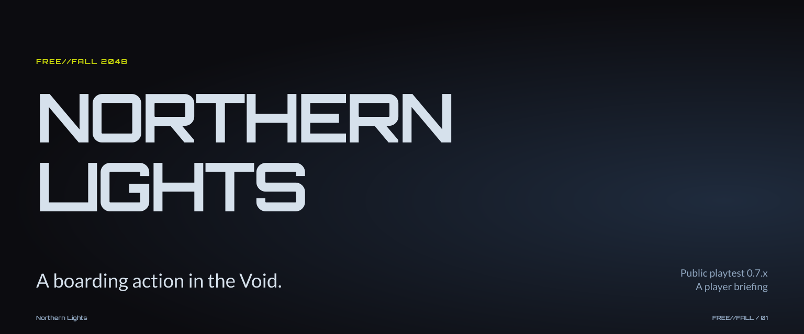
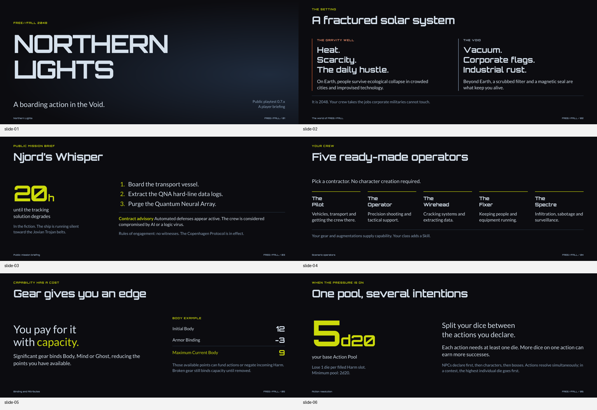
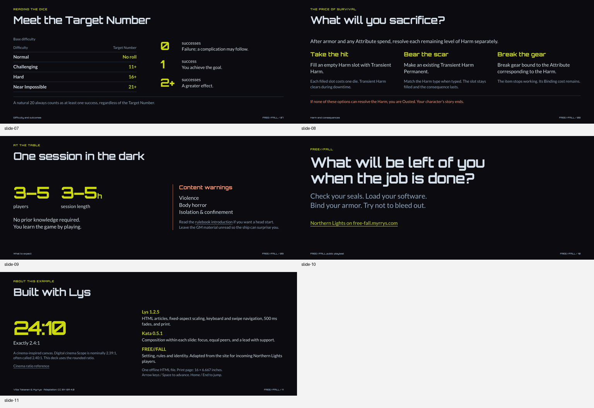

# Kata 0.5.1 in the Northern Lights player pitch

17 October 2026

The owner judged this eleven-slide pitch an improvement over the previous deck, while finding the slides packed with large text, lacking balance and difficult to read. The rebuild clarified the content and its organisation, but the composition did not meet the owner's expectations. The initial report gave too much weight to named relationships, content preservation and successful fit checks when assessing the result.

The central finding is a failure to translate Kata's existing ideas about restraint, balance and dominance into effective choices of scale and density. This use does not establish whether the guidance was insufficiently actionable, the agent applied it mechanically, or both. More examples for wide surfaces may help investigate that failure; their absence is not an established explanation.

This is a worked use of Kata, not a controlled evaluation. One agent researched, authored, composed and checked the deck. The owner's subsequent review, recorded below on 17 October 2026, revises that agent's assessment. There was no separate evaluator before delivery or player comprehension study.

## Brief and deliverables

The audience is people arriving from the FREE//FALL site to play **Northern Lights**. The deck introduces the setting, the public job, the available operator roles and enough of the rules to make their trade-offs inviting. It is a player pitch and orientation, not a complete rules reference or a recruitment offer for playtest volunteers.

- [Maintained HTML source](../../examples/square.html). The legacy filename remains so existing links continue to work.
- [Standalone built deck](../../site/examples/square.html), recreated by `pnpm build`. Lys, Lato and Orbitron are embedded; opening the file does not fetch assets.
- [Authored content and source record](free-fall-northern-lights-content.json).
- [Verification record](free-fall-northern-lights-checks.json).

The original FREE//FALL dark palette, Lato/Orbitron identity, exact **24:10** surface, **500 ms** fade and **16 × 6.667 inch** print page are retained. The last slide explains how Lys, Kata and the game material contribute. It also distinguishes the exact **2.4:1** canvas from nominal digital cinema **Scope at 2.39:1**, commonly called 2.40:1. This is a cinema-inspired HTML presentation, not a DCI delivery. The ratio explanation links to [Sony's specifications](https://partnerzone.sonypictures.com/spe-video-master-specs.html); the [ISDCF registry](https://www.isdcf.com/registry/projectoraspectratios/) confirms the Scope designation.

## Owner review and revised assessment

The owner described the result as better than the previous version, but questioned how the **24:10** surface should inform the expected amount of text and what counts as too large. Their compositional assessment was: “here all slides are packed with large text. No balance, very unlegible.” This is direct owner feedback about the delivered result, not a measured finding about every reader or a problem confined to portrait phones.

The agent's revised interpretation is that recurring large headings, emphatic numbers or phrases, and several supporting blocks competed for attention. Space was used mainly to separate those text blocks. The agent did not successfully judge their combined visual weight or create enough quiet within each composition. Giving fields a named relationship did not establish that their relative scale was effective.

The aspect ratio specifies the shape to compose within. It does not supply a word budget or a type scale. Viewing distance, display size, intended reading effort and communicative purpose should inform those choices. This run checked viewport dimensions without first establishing a sufficiently concrete viewing and reading target. On a shallow surface, enlarging a heading also spends height that its surrounding material needs; simply shrinking all text would not resolve the underlying judgment problem.

Technical fit and content fidelity remain useful evidence. The agent's visual inspection also found delivery defects, but failed to recognise the overall compositional problem raised by the owner. Both the output and that assessment need to inform the next use of Kata.

## Inputs and responsibility

The latest local Kata checkout was **0.5.1**, commit `ed08e83655ac04bb1f3069b15369ac32e662a037`. The Lys repository's vendored Kata copy already matched it. The applied material was the gateway plus **practices**, **composition** and **integration**, rather than the historical information-type catalogue. The Kata development harness's pinned Lys authoring guidance was read; the existing demo continues to build with the Lys repository's **1.2.5** runtime, without changing either pin or engine.

The public site was re-read on 17 October 2026: its home page, introduction, world, characters and crews, core rules, tools, SRD, about page and public Northern Lights landing page. Source URLs and response hashes are recorded with the authored copy. No GM scene, opposition, backstory or character-sheet page was used. The public mission's threat assessment remains an employer **advisory**, not a revelation about what is actually aboard.

Content selection, paraphrase, slide boundaries and order were authoring work under the user's request. The selected copy was recorded before applying the composition CSS. Kata then governed placement, scale, grouping, emphasis and inspection. The tests compare the rendered HTML text and notes with that record. This is a practical boundary within one agent's work, not a blind handoff between independent authors.

### Corrections made during source authoring

| Old pitch or source tension | Treatment in this deck |
| --- | --- |
| The previous demo described natural 20s as exploding into more dice. | The current rule is at least one success regardless of TN. Attack-specific critical details stay in the subject notes. |
| The previous demo treated filling all three Harm slots as immediate ousting. The introduction also loosely describes making Harm Permanent as keeping a slot open. | The detailed Core Rules govern: the slot stays filled, and the player may still make eligible Harm Permanent or break appropriate bound gear. Ousting happens when no option can resolve incoming Harm. |
| The previous pitch promised tester credits, early access and a free release, with a 3–4 hour commitment. | These promises are removed. The scenario supplies **3–5 players**, **3–5 hours**, ready-made operators and content warnings. |
| The old “Equality” explanation said GM and players use the same rules. | It is not repeated. The current rule concerns players deciding the resolution order in a tie. |
| Home, introduction and SRD expose different patch-level labels. | The pitch uses the scenario's **public playtest 0.7.x** designation. |

These corrections came from source checking. Kata's preservation rules cannot determine whether supplied game rules are current or correct. The content adaptation credits Ville Takanen and Kustannusosakeyhtiö Myrrys and carries CC BY-SA 4.0 attribution and reuse information, following the site's [About page](https://free-fall.myrrys.com/about/). Font licenses are embedded in the HTML.

## Intended composition choices

The alternatives below were considered in choosing the final arrangement. They were not all implemented as visual variants. The table records the agent's intentions and reasoning; the owner's review shows that these rationales did not establish a balanced or comfortably legible result.

| Slide | Choice and communicative role | Alternative and trade-off |
| --- | --- | --- |
| 1 Northern Lights | **One focus.** Large title at a common left edge, with open space to the right. The restrained colour field retains the existing identity. | A quiet centred title would feel less like an incoming briefing. No invented ship image was needed. |
| 2 The world | **Equal peers.** Earth and space share widths, heading sizes and alignment. Warm/cool rules distinguish the environments without ranking them. | Giving the Void most of the surface would foreground this mission but weaken the setting's duality. |
| 3 The mission | **A lead with support.** The 20-hour window dominates; its fictional meaning and label stay attached. The actual objectives occupy more reading width. | Three equal mission cards would fragment the public brief and bury the time constraint. The ordered objectives are authored from the supplied mission, not inferred by Kata. |
| 4 Operators | **Equal peers.** Five matching fields give every available role a place in one scan. Short descriptions and equal title treatment avoid selecting a favourite. | Two rows would provide more line length, but the odd fifth item would need careful treatment to avoid looking secondary. |
| 5 Binding | **A lead with support.** The capacity cost is the lead; a supplied 12 minus 3 example supports it. “Maximum Current” stays with 9. | Giving 9 the whole slide would turn an example into the apparent rule. The ledger itself was authored before composition. |
| 6 Action Pool | **A lead with support.** 5d20 leads, with the Harm penalty and 2d20 floor beside it. The second field explains allocating dice. | Equal scale for every sentence would make the pool harder to locate. Excessively enlarging it would crowd out the floor and penalty. |
| 7 Reading the roll | **Shared practices on a composite surface.** Keep the supplied difficulty lookup as a table. Put outcome definitions beside it and the natural-20 exception across the group. | A chart would replace the authored representation; a process diagram would imply a different relationship. No named form was forced onto the table's internals. |
| 8 Harm | **Equal peers.** Three possible sacrifices share typography and space. Each keeps its eligibility and cost; the shared ousting condition sits immediately below the options. | A dominant “take the hit” panel would imply a preferred choice. An ordered flow would misrepresent alternatives as mandatory steps. |
| 9 At the table | Equal treatment of player count and real session duration, with a separate, prominent warning group. | Putting warnings into the recurring footer would make meaningful participation information look like a credit. |
| 10 Invitation | **One focus.** The game's question has the largest presence, followed by the public invitation and an actual scenario link. | A grid of benefits would dilute the question and require unsupported sales copy. |
| 11 Colophon | **A lead with support.** The exact ratio leads its qualification; the other field explains the renderer, composition guidance and game material. | A token dump would obscure the distinction between author choices and Lys behaviour. This technical slide is present because the user explicitly requested it. |

Layout rationale stays here, outside the audience content and subject notes. The colophon identifies the tools but does not turn the pitch into a design critique.

## What Kata contributed

**The small repertoire gave the agent a vocabulary for relationships.** One focus was selected for the title and closing question, equal peers for the worlds and operators, and lead with support for emphatic numbers and their context. These selections did not require invented data relationships. They also did not ensure successful scale, density or balance.

**The shared practices did more than the names.** The most consequential choices concerned proximity and qualification: the fictional deadline versus real session hours, “maximum” versus currently available Body, the minimum Action Pool, and Harm eligibility. The instructions to keep qualifications attached made these explicit review targets.

**It prompted reasons for familiar layouts, without ensuring those reasons survived review.** The agent used matching weight and distinct roles to justify columns for the roster and Harm choices. Borders were reduced to separators and shared rules. The result still relied heavily on typography and columns, and the owner's criticism exposes the limits of that justification. Naming the intended relationship was easier than judging the whole composition.

**Its inspection requirement found a real delivery defect.** An initial WebKit overflow prompted a change to the canvas wrapper. A subsequent PDF passed page count and page-size checks, yet visual inspection showed a retained stacked-mode offset pushing half the slide off-page. The author CSS now clears that offset in print, and the regression test measures slide edges as well as page count. Lys's engine was unchanged.

## What was lacking

1. **Effective judgment of scale, density and balance.** The existing [shared practices](../../.agents/skills/kata/references/practices.md) already ask for deliberate visual weight, whitespace and restraint, and explicitly allow a modest heading to let the subject lead. Those ideas were not absent. In this use, the agent did not turn them into effective decisions. The unresolved question is whether their expression needs to become more actionable, their application needs to improve, or both. The case does not justify another generic checklist on its own.
2. **A concrete viewing and reading target.** The specified ratio was treated as enough context for selecting scale. The composition needed a clearer account of how the audience would read it before deciding what was prominent, comfortable or dense. This is context for composing the specified static surface; it does not require Kata to own responsive reflow or renderer behaviour. No universal word quota or type-size rule follows from 24:10.
3. **Review that distinguishes fit from compositional success.** Automated checks established geometry and preservation. The agent's rendered review caught clipping but still accepted competing emphasis and insufficient balance. Future review of this case needs to address what attracts attention, what can remain quiet and whether the complete item can be read comfortably in its intended conditions. That is a design judgment to record, not a claim established by passing tests.
4. **Examples that expose these decisions.** A wide, shallow surface, a five-person roster and a table beside its explanation remain useful cases. The initial report treated missing examples as the main gap too quickly. Their value would be in making real alternatives in scale, density and emphasis inspectable, rather than supplying another arrangement to imitate.

Portrait-phone scaling is a separate delivery limitation: general body text is about 26.9 px on the 1536 px cinema canvas and 6.8 px at a 390 px portrait width; some support is smaller. That does not explain away the owner's broader criticism of oversized text and poor balance within the compositions.

Researching the setting, resolving source conflicts, choosing spoilers to exclude and deciding the deck's sequence are necessary authoring responsibilities, not missing Kata features. The report does not propose adding them to Kata. No shared skill or harness guidance was changed during this use.

The next useful investigation would retain one slide's authored copy and exact 24:10 surface, state its viewing and reading conditions, then render two meaningful alternatives that differ in heading scale, emphasis, grouping and use of space. The world or Harm slide would keep the comparison bounded. Record which existing guidance drove each decision, and obtain owner review of balance and legibility before calling either result successful. This could help distinguish an application failure from unclear guidance. Any change to the shared kit should follow the observed correction. This is proposed follow-up work; the deck and shared guidance have not been revised in response to this feedback.

## Verification and limits

The following checks describe the delivered artifact's technical behaviour and the coverage of the agent's inspection. They do not establish aesthetic acceptance or comfortable legibility. The owner's subsequent review rejects the initial assessment of balance and readability while recognising improvement over the previous deck.

- Build and type check passed. Lys lint passed with two informational notices in pre-existing ignored scratch files. All **192 unit tests** passed. Kata's project check passed without changing Kata files.
- The focused browser suite passed **47 tests**, with **4 expected skips** for native PDF export in Firefox/WebKit. Chromium, Firefox and WebKit checked text fit and 24:10 geometry at **1536×640**, **1440×900**, **390×844** and **844×390**, with JavaScript enabled and disabled.
- Keyboard checks covered Arrow Right, Home and End, focus movement and hidden-slide accessibility state. Copied-file checks blocked HTTP(S) requests and confirmed the bundled fonts and renderer load without external requests. The source does not add custom interaction code.
- Visual review covered every slide at **1536×640**, phone portrait and landscape samples, the changed example listing at **1280×720** and **390×844**, and CSS-only output. The listing's Northern Lights link opened the rebuilt deck. The existing documentation tables elsewhere on the listing page were outside this change.
- Chromium produced **11 pages**, each **1152×480 points**, with and without JavaScript. All final PDF pages were rendered and visually inspected; the dense Harm slide and CSS-only colophon received full-size checks. Text extraction was checked against the authored copy after normalising whitespace, ligatures and ordered-list markers.
- Physical phones, real touch gestures, screen readers and native Firefox/Safari print dialogs were not tested. The contrast regression checks the slide foreground/background pair; it is not a complete accessibility audit. No claim of improved player understanding is made.

Portrait phone scaling faithfully preserves the composition but is too small for comfortable reading. Desktop, shared-screen and larger PDF viewing were the intended uses; the owner's criticism still leaves their compositional quality unresolved. A separately authored mobile presentation would be a different surface and would not address the reported balance problem in this one.

### Final printed compositions

